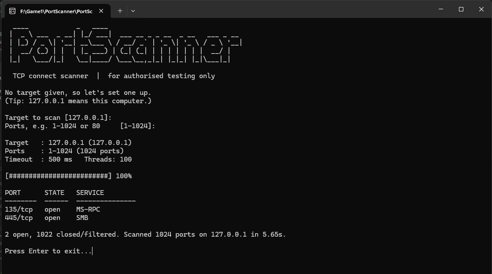

# PortScanner

A fast, multi-threaded **TCP connect port scanner** written in C++ — a tiny, from-scratch take on what tools like Nmap do. Built as a learning project to understand sockets, TCP, and how attackers and defenders discover exposed services.

> ⚠️ **For educational and authorised use only.** Only scan machines you own or have **explicit written permission** to test. See [Ethics & legal](#ethics--legal).



## Features

- **TCP connect scanning** — completes a real TCP handshake to decide whether a port is open
- **Multi-threaded** — scans up to 500 ports at the same time (thousands of ports in seconds)
- **Configurable timeouts** using non-blocking sockets + `select()`, so filtered ports don't stall the scan
- **Service detection** for ~40 well-known ports (SSH, HTTP, SMB, RDP, MySQL…)
- **Hostname resolution** (`localhost`, `example.lan`) as well as raw IPv4 addresses
- **Interactive mode** when started with no arguments, so it works with a double-click
- **Live progress bar** and an Nmap-style results table
- **Save results** to a text file with `-o`
- **Built-in safety check** — asks you to confirm permission before scanning anything that isn't your own machine
- Cross-platform: Windows (Winsock) and Linux/macOS (POSIX sockets)

## How it works

1. **Resolve** the target name to an IPv4 address with `getaddrinfo()`.
2. **Start worker threads.** Each one repeatedly takes the next unscanned port from a shared atomic counter.
3. For each port, create a TCP socket, switch it to **non-blocking** mode and call `connect()`.
4. Use **`select()`** to wait up to the timeout. If the socket becomes writable *and* `SO_ERROR` is 0, the three-way handshake succeeded → **open**. A refusal (RST) or timeout → **closed/filtered**.
5. Collect open ports (protected by a mutex), sort them, and print the report.

```
 Scanner                Target
   | ---- SYN ---------->  |
   | <--- SYN/ACK -------  |   port OPEN
   | ---- ACK ---------->  |
   |                       |
   | ---- SYN ---------->  |
   | <--- RST -----------  |   port CLOSED
```

## Building

### Windows (Visual Studio)

1. Create a new **Console App** project (C++).
2. Replace the generated `.cpp` file with `PortScanner.cpp`.
3. Set **Project → Properties → C/C++ → Language → C++ Language Standard** to **ISO C++17** or newer.
4. Build with **Ctrl+Shift+B**. Winsock (`Ws2_32.lib`) is linked automatically via `#pragma comment`.

To pass arguments while debugging, go to **Project → Properties → Debugging → Command Arguments** and enter, for example, `127.0.0.1 -p 1-1024`.

### Linux / macOS

```bash
g++ -std=c++17 -O2 -pthread PortScanner.cpp -o portscanner
```

## Usage

```
PortScanner <target> [options]

  -p <start-end>   Port range to scan       (default 1-1024)
  -p <port>        Scan a single port
  -t <ms>          Timeout per port in ms   (default 500)
  -j <threads>     Ports scanned at once    (default 100)
  -o <file>        Save results to a text file
  -y, --yes        Skip the permission confirmation
  -h, --help       Show help
```

**Interactive mode:** run `PortScanner` with no arguments (or double-click it / press Ctrl+F5) and it will ask you for a target and port range, then wait for Enter before closing.

### Examples

```bash
# Scan the 1024 well-known ports on your own machine
PortScanner 127.0.0.1

# Full scan of every port, faster settings
PortScanner localhost -p 1-65535 -t 200 -j 300

# Check a single port on a lab VM you own and save the result
PortScanner 192.168.56.101 -p 22 -o results.txt
```

### Example output

```
Target   : 127.0.0.1 (127.0.0.1)
Ports    : 1-10000 (10000 ports)
Timeout  : 200 ms   Threads: 200

[#########################] 100%

PORT      STATE   SERVICE
--------  ------  ---------------
135/tcp   open    MS-RPC
445/tcp   open    SMB
3000/tcp  open    Dev-server
8080/tcp  open    HTTP-proxy

4 open, 9996 closed/filtered. Scanned 10000 ports on 127.0.0.1 in 0.09s.
```

## Safe ways to practise

- Scan **`127.0.0.1`** (your own computer). Start a test service first, e.g. `python -m http.server 8080`, and watch it appear.
- Set up a **home lab**: a virtual machine in VirtualBox/VMware (e.g. Metasploitable or an Ubuntu VM) on a host-only network.
- Use deliberately legal targets such as **`scanme.nmap.org`**, which the Nmap project allows light scanning of.

## Ethics & legal

Port scanning a system you don't own or aren't authorised to test may be illegal — for example under South Africa's **Cybercrimes Act 19 of 2020**, the **Computer Misuse Act 1990** (UK) or the **Computer Fraud and Abuse Act** (US) — and is against the terms of most ISPs and hosting providers. Even when it isn't illegal, unexpected scans can trigger security alerts and get your IP blocked.

This tool is meant for **learning, home labs, CTFs, and authorised security assessments**. The author takes no responsibility for misuse. Always get permission in writing first.

## Limitations & ideas for the future

- IPv4 only (IPv6 support would be a good next step)
- TCP connect scans only — no SYN ("half-open") or UDP scanning, which need raw sockets/admin rights
- Service names come from the port number, not from talking to the service
- Ideas: banner grabbing, scanning a whole subnet (CIDR), JSON/CSV output, a "top 100 ports" mode

## What I learned

- How TCP's three-way handshake reveals whether a port is open
- Using Winsock / Berkeley sockets in C++ (`socket`, `connect`, `select`, `getsockopt`)
- Non-blocking I/O and timeouts
- Multi-threading with `std::thread`, `std::atomic` and `std::mutex`
- Building a clean command-line interface and validating user input
- The legal and ethical responsibilities that come with security tools

## License

© 2026 Luhan Bezuidenhout. All rights reserved.

You're welcome to view this code, but you may not copy, modify or redistribute it without my written permission.
